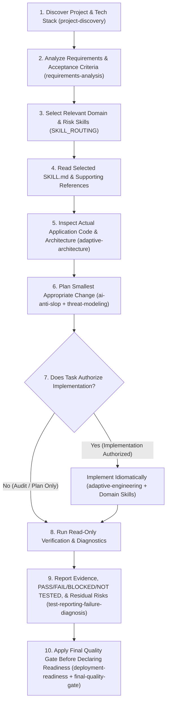

# Skill Routing & Interoperability Guide (`SKILL_ROUTING.md`)

This document explains how the 38 skills in the **Reusable AI Development Skills Library** work together across the software engineering lifecycle, when each skill should be activated, how skills hand off context and evidence to one another, and how Antigravity discovers and loads them.

---

## 1. How Antigravity Discovers and Loads Skills

### Important Operational Reality
Creating a Markdown catalog (`SKILL_CATALOG.md` or `SKILL_ROUTING.md`) does **not** automatically register or activate skills in Antigravity. Antigravity discovers skills through its filesystem and JSON configuration discovery system and loads them using **Progressive Disclosure**:

1. **Discovery Phase (Startup)**:
   Antigravity scans configured customization roots for `<skill-name>/SKILL.md` files:
   - Workspace default: `<workspace-root>/.agents/skills/<skill-name>/SKILL.md`
   - Workspace declarative config: `<workspace-root>/.agents/skills.json`
   - Global user config: `~/.gemini/config/skills/<skill-name>/SKILL.md` or `~/.gemini/config/skills.json`
   - Installed plugins: `~/.gemini/config/plugins/<plugin-dir>/skills/<skill-name>/SKILL.md`
2. **Metadata Injection (~100 tokens/skill)**:
   Only the `name` and `description` fields from each discovered `SKILL.md` YAML frontmatter are injected into the agent's system prompt at conversation start.
3. **On-Demand Activation (< 5,000 tokens)**:
   When the user's request matches a skill's `description` (or when the user invokes `/<skill-name>`), the agent calls `read_file` on that skill's `SKILL.md` to load its full workflow.
4. **Progressive Reference Loading**:
   Detailed checklists, matrices, and scripts inside `references/` or `scripts/` are read only when a step in `SKILL.md` instructs the agent to load them.

---

## 2. The 10-Step Master Engineering Workflow

Across all projects and technology stacks, agents using this library follow a disciplined 10-step lifecycle:

1. **Discover the project and its technology stack** (`project-discovery`).
2. **Understand the requested task and acceptance criteria** (`requirements-analysis`).
3. **Identify the relevant skills and risk areas** (using the routing matrix below).
4. **Read the selected skill instructions and supporting references** (progressive disclosure).
5. **Analyze the application before making recommendations** (`adaptive-architecture`, `refactoring-legacy-safety`).
6. **Plan the smallest appropriate change** (`ai-anti-slop`, `threat-modeling-risk-assessment`).
7. **Implement only when the user's task authorizes implementation** (`adaptive-engineering` + domain skills).
8. **Verify the work with appropriate checks** (`code-quality-static-analysis`, `backend-testing-tdd`, `playwright-mcp-browser-qa`, `accessibility-engineering`).
9. **Report evidence, limitations, and unresolved risks** (`test-reporting-failure-diagnosis`).
10. **Apply the final quality gate before declaring deployment readiness** (`deployment-readiness` + `final-quality-gate`).

---

## 3. Task-to-Skill Routing Matrix

Do **not** activate all 38 skills indiscriminately. Select the minimum coherent set of skills that covers the task's domain and risk profile:

| Task / Scenario | Primary Skills to Activate (In Order) | Conditional / Secondary Skills |
| :--- | :--- | :--- |
| **New Project / Onboarding / Codebase Audit** | `01 project-discovery` -> `02 requirements-analysis` -> `03 adaptive-architecture` | `04 technical-decision-records`, `13 threat-modeling-risk-assessment` |
| **UI / Frontend Feature or Redesign** | `01 project-discovery` -> `05 ai-anti-slop` -> `20 ui-ux-design-systems` -> `21 accessibility-engineering` -> `23 cross-browser-responsive-qa` -> `17 playwright-mcp-browser-qa` | `22 frontend-performance`, `36 seo-web-discoverability` (if public page) |
| **Backend Feature or Business Logic Change** | `01 project-discovery` -> `02 requirements-analysis` -> `06 adaptive-engineering` -> `10 application-security-owasp` -> `16 backend-testing-tdd` -> `07 code-quality-static-analysis` | `05 ai-anti-slop`, `12 privacy-data-protection` (if handling PII), `30 caching-background-jobs` |
| **Database Schema or Query Change** | `01 project-discovery` -> `24 database-architecture-integrity` -> `25 query-optimization-performance` -> `18 test-data-environment-isolation` -> `16 backend-testing-tdd` | `35 backup-recovery-disaster-preparedness`, `12 privacy-data-protection` |
| **CSV / Spreadsheet Import or Export** | `02 requirements-analysis` -> `26 import-export-data-processing` -> `10 application-security-owasp` -> `24 database-architecture-integrity` -> `16 backend-testing-tdd` | `30 caching-background-jobs` (for async large-file imports), `12 privacy-data-protection` |
| **Webhook or External API Integration** | `11 api-security-webhook-reliability` -> `27 api-external-service-integration` -> `18 test-data-environment-isolation` -> `16 backend-testing-tdd` | `13 threat-modeling-risk-assessment`, `30 caching-background-jobs` |
| **LLM / AI Feature Integration** | `28 ai-provider-integration` -> `14 ai-security-prompt-injection` -> `12 privacy-data-protection` -> `16 backend-testing-tdd` | `05 ai-anti-slop`, `20 ui-ux-design-systems` (for streaming/chat UI states) |
| **Legacy Code Refactoring or Cleanup** | `01 project-discovery` -> `08 refactoring-legacy-safety` -> `15 testing-strategy-design` -> `16 backend-testing-tdd` -> `07 code-quality-static-analysis` | `05 ai-anti-slop` (for code comment and dead-code hygiene) |
| **Dependency Upgrade or CVE Remediation** | `09 dependency-supply-chain-security` -> `06 adaptive-engineering` -> `07 code-quality-static-analysis` -> `16 backend-testing-tdd` -> `19 test-reporting-failure-diagnosis` | `31 ci-cd-release-engineering` |
| **Performance Bottleneck Investigation** | `29 performance-profiling-optimization` -> `25 query-optimization-performance` (DB) / `22 frontend-performance` (UI) / `30 caching-background-jobs` (Async) | `34 observability-incident-diagnosis` |
| **CI/CD Pipeline or Config Hardening** | `31 ci-cd-release-engineering` -> `32 environment-configuration-management` -> `09 dependency-supply-chain-security` | `33 deployment-readiness` |
| **Production Incident Diagnosis** | `34 observability-incident-diagnosis` -> `19 test-reporting-failure-diagnosis` -> `08 refactoring-legacy-safety` -> `16 backend-testing-tdd` | `35 backup-recovery-disaster-preparedness` (if data corruption occurred) |
| **Release Preparation & Final Audit** | `32 environment-configuration-management` -> `33 deployment-readiness` -> `10 application-security-owasp` -> `19 test-reporting-failure-diagnosis` -> `37 documentation-developer-handoff` -> `38 final-quality-gate` | `35 backup-recovery-disaster-preparedness`, `36 seo-web-discoverability` |

---

## 4. Interoperability Rules & Conflict Resolution

To prevent circular dependencies, duplicated instructions, and conflicting policies across skills, all 38 skills obey the following hierarchy of authority:

1. **Evidence & Integrity Hierarchy**:
   - **Safety & Security (`SKILL-09`..`SKILL-14`, `SKILL-18`, `SKILL-32`)** always outrank convenience or speed. No skill may bypass authentication, disable security controls, expose secrets, or run destructive tests against production data.
   - **Honesty & Verification (`SKILL-05`, `SKILL-19`, `SKILL-33`, `SKILL-38`)** outrank completion speed. No skill may fabricate test results, invent unmeasured performance numbers, or declare a build `READY` when mandatory checks are `FAIL`, `BLOCKED`, or `NOT TESTED`.
2. **Technology Stack Authority (`SKILL-01`, `SKILL-06`)**:
   - `project-discovery` (`SKILL-01`) establishes the factual technology inventory for the workspace.
   - Every downstream skill (`SKILL-07` through `SKILL-37`) adapts its commands and patterns to that verified inventory rather than assuming PHPStan, Pint, Pest, `shadcn/ui`, Playwright, or GitHub Actions.
3. **Single Responsibility & Clean Handoffs**:
   - Each skill defines **Upstream Skills** (whose outputs it consumes) and **Downstream Skills** (to which it hands off verification).
   - Skills reference shared policies (such as OWASP ASVS, WCAG 2.2, Anti-Slop `R-01`..`R-40`, and the 15-point Quality Gate) via concise summaries and relative links to `references/` rather than duplicating multi-page specifications inline.
4. **Mandatory Integration Between `deployment-readiness` (`SKILL-33`) and `final-quality-gate` (`SKILL-38`)**:
   - `deployment-readiness` evaluates operational, infrastructure, migration, backup, and rollback safety and outputs a structured readiness package.
   - `final-quality-gate` consumes that operational readiness package alongside functional, code quality, security, test (`SKILL-19`), accessibility (`SKILL-21`), and documentation (`SKILL-37`) evidence to render one of the four binding release verdicts: **`READY`**, **`READY WITH ACCEPTED RISKS`**, **`BLOCKED`**, or **`INCOMPLETE`**.
